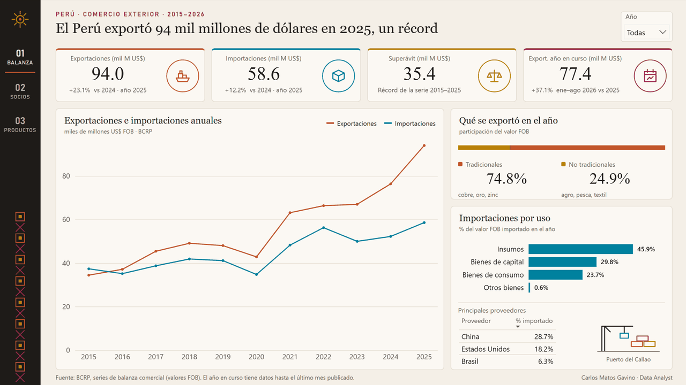
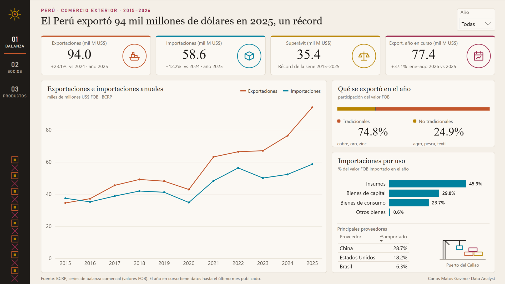
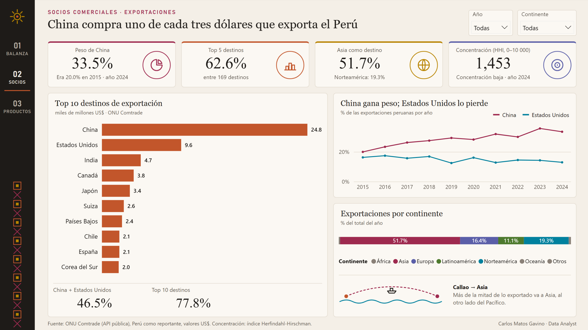
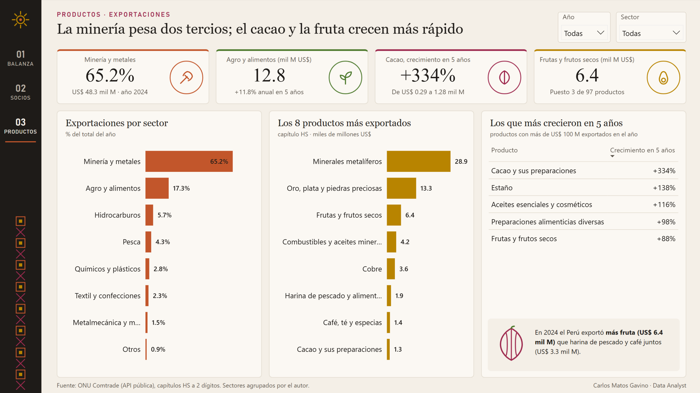

# Comercio exterior del Perú, 2015–2026

Tablero de Power BI que responde tres preguntas con datos oficiales: **cuánto exporta e importa el Perú, a quién le vende y qué vende**. Va de punta a punta: extracción desde APIs públicas con Python, modelo estrella, análisis en SQL, 65 medidas DAX y un diseño propio.



## Hallazgos

- **Récord de exportaciones en 2025:** US$ 94.0 mil millones FOB, **+23.1%** frente a 2024. El superávit comercial llegó a US$ 35.4 mil millones, el más alto de la serie 2015–2025.
- **El año sigue acelerando:** de enero a agosto de 2026 se exportaron US$ 77.4 mil millones, **+37.1%** frente al mismo periodo de 2025.
- **China compra uno de cada tres dólares** que exporta el Perú: 33.5% en 2024, frente a 20.0% en 2015. Estados Unidos bajó de 16.3% a 12.9%.
- **Asia recibe el 51.7%** de las exportaciones. Aun así, la concentración por destino es baja: índice Herfindahl-Hirschman de 1,453 sobre 10,000.
- **La minería pesa dos tercios** (65.2%) del valor exportado en 2024.
- **El agro es lo que más crece:** el cacao subió **+334%** entre 2019 y 2024 (de US$ 0.29 a 1.28 mil millones). La fruta ya suma US$ 6.4 mil millones, más que la harina de pescado y el café juntos.
- **Casi la mitad de lo importado son insumos** para la industria nacional (45.9% en 2025).

## Páginas

| Balanza comercial | Socios comerciales | Productos |
|---|---|---|
|  |  |  |

Cada página tiene segmentadores de año y de continente o sector. Los indicadores se recalculan para el año elegido. Si no se elige ninguno, usan el último año completo. Las series de tiempo ignoran el filtro de año a propósito, para que siempre se vea la tendencia completa.

## Cómo está hecho

```
APIs públicas ──► Python (Pandas) ──► CSV en modelo estrella ──► SQLite (SQL de análisis)
                                                    └──────────► Power BI (TMDL + DAX + PBIR)
```

1. **Extracción** ([etl/etl.py](etl/etl.py)):
   - Fuentes:
     - [BCRP](https://estadisticas.bcrp.gob.pe): balanza comercial mensual.
     - [ONU Comtrade](https://comtradeapi.un.org): comercio anual por país socio y por capítulo del Sistema Armonizado.
   - Las respuestas se guardan en caché y los errores 429 y 5xx se reintentan.
2. **Transformación:**
   - El resultado es un modelo estrella de tres tablas de hechos (balanza mensual, socios, productos) con dimensiones compartidas (fecha, flujo, país, producto).
   - Los nombres de países están en español (CLDR) y cada uno lleva su continente.
   - Los 97 capítulos HS están traducidos y agrupados en 8 sectores.
   - Controles de calidad:
     - claves únicas;
     - sin huérfanos;
     - fechas dentro del calendario;
     - cruce BCRP vs. Comtrade: las exportaciones de 2023 difieren 3.5%, una diferencia esperada porque las metodologías son distintas.
3. **SQL** ([sql/analisis.sql](sql/analisis.sql)): ocho consultas sobre SQLite con funciones de ventana (`LAG`, `RANK`, sumas acumuladas):
   - variación interanual;
   - top 10 de destinos con participación acumulada;
   - índice Herfindahl-Hirschman;
   - crecimiento anual compuesto por sector;
   - estacionalidad.
4. **Power BI** ([powerbi/](powerbi)): es un proyecto PBIP, en archivos de texto versionables.
   - Modelo en TMDL con 65 medidas DAX: año de análisis dinámico, variaciones, rankings con `RANKX` y `TOPN`, HHI con `SUMX`, crecimiento compuesto y textos dinámicos para los indicadores.
   - Las páginas en PBIR y los fondos se generan con [powerbi/build_pbip.py](powerbi/build_pbip.py) a partir de un único plano de posiciones.
   - [powerbi/validate_pbir.py](powerbi/validate_pbir.py) valida cada archivo contra los esquemas oficiales de Microsoft.

### Diseño: "Tierra y Pacífico"

La paleta sale de lo que el Perú exporta y de sus tintes:

| Color | Hex | Uso |
|---|---|---|
| Cobre | `#C2562B` | exportaciones |
| Pacífico | `#00819E` | importaciones |
| Lúcuma | `#B88400` | |
| Cochinilla | `#9E2A4F` | |
| Índigo | `#5B5FA8` | |
| Muña | `#4E7A2E` | |

El fondo es color hueso. La paleta se validó para protanopia, deuteranopia y tritanopia, y para contraste sobre el fondo. La barra lateral lleva un sol inca y un motivo inspirado en los tocapus andinos. Las reglas del diseño:

- Los títulos cuentan el hallazgo, no el nombre del gráfico.
- Cada color tiene un solo significado en todas las páginas.
- Un solo eje por gráfico.
- La fuente va al pie de cada página.

## Reproducirlo

```bash
pip install -r requirements.txt
python etl/etl.py          # descarga y arma data/processed/*.csv
python etl/run_sql.py      # carga SQLite e imprime las 8 consultas
```

Abre `powerbi/ComercioExteriorPeru.pbip` en Power BI Desktop y haz clic en **Actualizar**. Si clonaste el repositorio en otra ruta, primero cambia el parámetro `RutaDatos` (Transformar datos › Administrar parámetros) a tu carpeta `data/processed/`.

## Estructura

```
comercio-exterior-peru/
├── etl/            etl.py (extracción y modelo), run_sql.py (SQLite + consultas)
├── sql/            schema.sql, analisis.sql
├── data/processed/ tablas del modelo estrella (CSV)
├── powerbi/        proyecto PBIP, generador, validador y fondos de página
└── docs/img/       capturas y GIF
```

---

**Carlos Matos Gavino**, Data Analyst · Lima, Perú · [LinkedIn](https://www.linkedin.com/in/carlos-matos-gavino)

<details>
<summary>English summary</summary>

Power BI dashboard on Peru's foreign trade (2015–2026) built end to end from official open data: Python ETL from the Central Reserve Bank of Peru (BCRP) and UN Comtrade APIs, a star schema, SQL analysis with window functions, a TMDL semantic model with 65 DAX measures, and a custom "Earth & Pacific" visual identity validated for color-vision deficiency. Key findings:

- Record exports of US$ 94.0 bn in 2025 (+23.1%).
- China takes 33.5% of exports, up from 20.0% in 2015.
- Mining is 65.2% of export value, while cacao grew +334% in five years.
</details>
