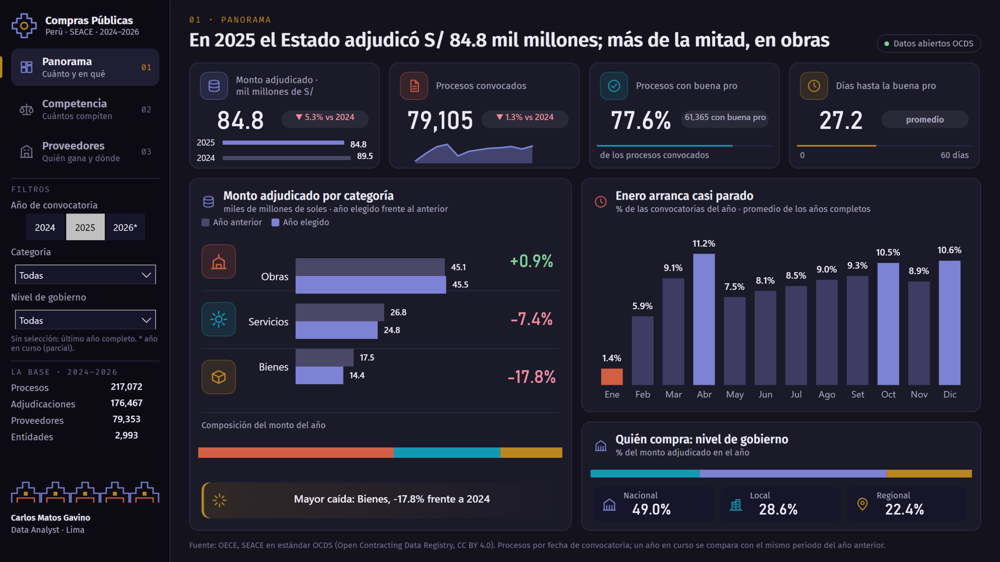
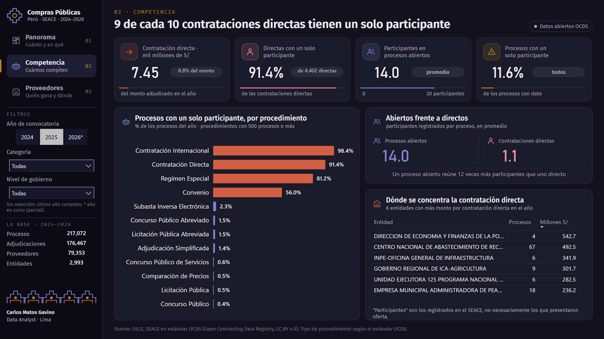
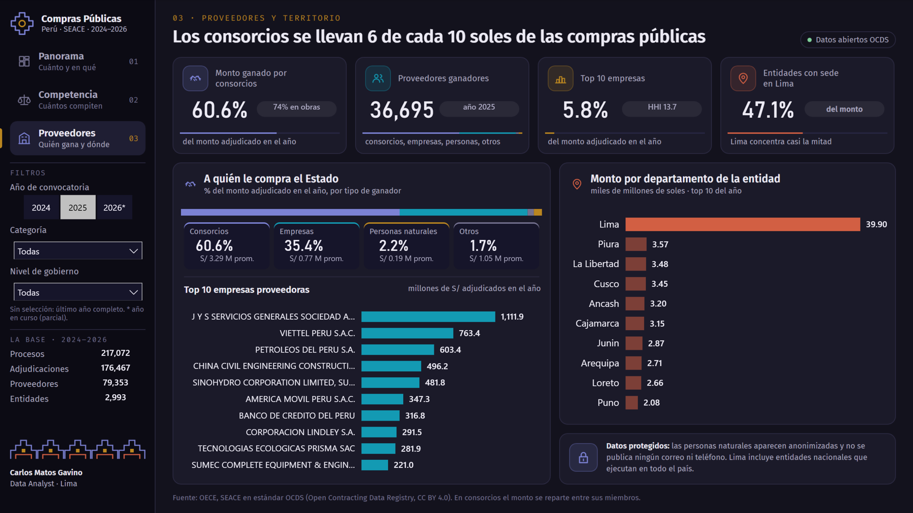

# Compras públicas del Perú, 2024–2026

Tablero de Power BI sobre **cuánto compra el Estado peruano, cuánta competencia hay en sus procesos y a quién le compra**. Usa los datos abiertos del SEACE en el estándar internacional OCDS: 217 mil procesos y 176 mil adjudicaciones. Va de punta a punta: ETL en Python, modelo estrella, análisis en SQL, 91 medidas DAX y un diseño propio en modo oscuro.


## Hallazgos

- **En 2025 el Estado adjudicó S/ 84.8 mil millones**, 5.3% menos que en 2024. Más de la mitad fue para obras (53.7%).
- **Los bienes cayeron 17.8%**, la mayor caída de las tres categorías. Las obras se mantuvieron (+0.9%).
- **Enero arranca casi parado:** solo el 1.4% de las convocatorias del año se publican en enero. Abril (11.2%) y diciembre (10.6%) son los meses más activos.
- **9 de cada 10 contrataciones directas tienen un solo participante** (91.4%). Suman S/ 7.45 mil millones, el 8.8% de lo adjudicado.
- **Un proceso abierto reúne 12 veces más participantes** que uno directo: 14.0 frente a 1.1 en promedio.
- **Los consorcios se llevan 6 de cada 10 soles** (60.6%), sobre todo en obras. Las personas naturales ganan el 2.2%.
- **El mercado de proveedores está muy disperso:** 36,695 ganadores en 2025. Las 10 empresas más grandes suman solo el 5.8% del monto (índice Herfindahl-Hirschman de 13.7 sobre 10,000).
- **Las entidades con sede en Lima concentran el 47.1%** del monto. Este dato incluye a entidades nacionales que ejecutan en todo el país.

## Páginas

| Panorama | Competencia | Proveedores y territorio |
|---|---|---|
|  |  |  |

La barra lateral tiene la navegación y tres filtros: año de convocatoria, categoría y nivel de gobierno.

- **Año sin elegir:** si no se elige un año, el tablero usa el último año completo.
- **Año en curso (2026\*):** se compara con el mismo periodo del año anterior, no con el año entero.
- **Gráficos que ignoran filtros:** algunos gráficos ignoran a propósito el filtro que los vaciaría. Por ejemplo, el desglose por categoría no se filtra por categoría.

## Cómo está hecho

```
OCDS del SEACE (CSV anuales) ──► Python (Pandas) ──► CSV en modelo estrella ──► SQLite (SQL de análisis)
                                                               └──────────► Power BI (TMDL + DAX + PBIR)
```

1. **Fuente:** [registro de datos del Open Contracting Partnership](https://data.open-contracting.org/en/publication/135), que publica las contrataciones del OECE (antes OSCE). La licencia es CC BY 4.0.
2. **Extracción y limpieza** ([etl/etl.py](etl/etl.py)):
   - **Versión de cada proceso:** los archivos anuales agrupan los procesos por su última actualización, no por su fecha de convocatoria. Por eso se leen los tres años, se conserva la versión más reciente de cada proceso y recién entonces se filtra por año de convocatoria.
   - **Montos:** se convierten a soles con el tipo de cambio que trae cada adjudicación. En un consorcio, el monto se reparte en partes iguales entre sus miembros.
   - **Tipo de ganador:** sale del RUC. 20 es empresa; 10 y 15 son personas naturales; 16 y 17 son consorcios. Muchos consorcios figuran con el RUC 10 de uno de sus miembros, así que también se reconocen por su nombre.
   - **Tipo de procedimiento:** los procedimientos de la nueva Ley 32069 llegan sin tipo OCDS y se clasifican a mano.
   - **Controles:**
     - claves únicas;
     - sin huérfanos;
     - ningún campo publicado contiene un RUC de persona natural;
     - el 1.38% del monto no tiene ganador identificado;
     - el 3.38% está en procesos atípicos, que se marcan pero no se borran.
3. **SQL** ([sql/analisis.sql](sql/analisis.sql)): diez consultas sobre SQLite con funciones de ventana:
   - resumen anual;
   - variación por categoría;
   - competencia por procedimiento;
   - top 10 de proveedores con participación acumulada;
   - índice Herfindahl-Hirschman;
   - departamentos;
   - nivel de gobierno;
   - estacionalidad.
4. **Power BI** ([powerbi/](powerbi)): es un proyecto PBIP, en archivos de texto versionables.
   - **Modelo:** en TMDL, con una tabla de año desconectada para comparar el año elegido con el anterior.
   - **91 medidas DAX:** mismo periodo del año anterior con `EDATE`, filtros Top N, HHI con `SUMX`, colores condicionales por medida y textos dinámicos (por ejemplo, "Mayor caída: Bienes, −17.8%").
   - **Generación:** las páginas en PBIR y los fondos se generan con [powerbi/build_pbip.py](powerbi/build_pbip.py) a partir de un único plano de posiciones.
   - **Validación:** [powerbi/validate_pbir.py](powerbi/validate_pbir.py) valida cada archivo contra los esquemas oficiales de Microsoft. Las cifras DAX se cuadraron contra las consultas SQL.

### Diseño: "Noche Paracas"

Este caso usa un modo oscuro inspirado en los mantos de Paracas, que tienen figuras de color vivo sobre fondo oscuro:

| Color | Hex | Uso |
|---|---|---|
| Índigo | `#7C82D4` | año elegido, gobierno nacional, consorcios |
| Terracota | `#D25F43` | obras, contratación directa, Lima |
| Turquesa | `#139AB3` | servicios, empresas |
| Oro | `#BA8620` | bienes, acento de la navegación |

La paleta se validó para protanopia, deuteranopia y tritanopia, y para contraste sobre el fondo oscuro. La barra lateral lleva una chakana (la cruz andina) y una greca escalonada. Los títulos cuentan el hallazgo, no el nombre del gráfico.

### Privacidad

Los proveedores que son personas naturales aparecen como "Persona natural", con un identificador anónimo. No se publica ningún correo, teléfono ni RUC de persona natural; el ETL lo verifica en cada ejecución.

## Reproducirlo

1. Descarga del [registro OCDS](https://data.open-contracting.org/en/publication/135) los CSV anuales 2024, 2025 y 2026 (`AAAA.csv.tar.gz`, unos 560 MB en total).
2. Guárdalos en `data/raw/`.
3. Ejecuta:

```bash
pip install -r requirements.txt
python etl/etl.py          # arma data/processed/*.csv (unos 3 minutos)
python etl/run_sql.py      # carga SQLite e imprime las 10 consultas
```

Abre `powerbi/ComprasPublicasPeru.pbip` en Power BI Desktop y haz clic en **Actualizar**. Si clonaste el repositorio en otra ruta, primero cambia el parámetro `RutaDatos` (Transformar datos › Administrar parámetros) a tu carpeta `data/processed/`.

## Estructura

```
compras-publicas-peru/
├── etl/            etl.py (lectura OCDS y modelo), run_sql.py (SQLite + consultas)
├── sql/            schema.sql, analisis.sql
├── data/processed/ tablas del modelo estrella (CSV)
├── powerbi/        proyecto PBIP, generador, validador, captura y fondos de página
└── docs/img/       capturas y GIF
```

---

**Carlos Matos Gavino**, Data Analyst · Lima, Perú · [LinkedIn](https://www.linkedin.com/in/carlos-matos-gavino)

<details>
<summary>English summary</summary>

Power BI dashboard on Peru's public procurement (2024–2026), built from SEACE open data in the Open Contracting Data Standard (217k tenders, 176k awards). It includes:

- a Python ETL that keeps the latest version of each tender, converts currencies and splits consortium awards;
- a star schema with SQL analysis;
- a TMDL model with 91 DAX measures, including same-period comparisons for the current year and Top N filters;
- a dark "Paracas Night" visual identity validated for color-vision deficiency.

Key findings for 2025:

- S/ 84.8 bn awarded (−5.3%).
- 91.4% of direct contracts had a single participant.
- Consortia won 60.6% of the amount.
- The top 10 companies hold only 5.8%.
</details>
